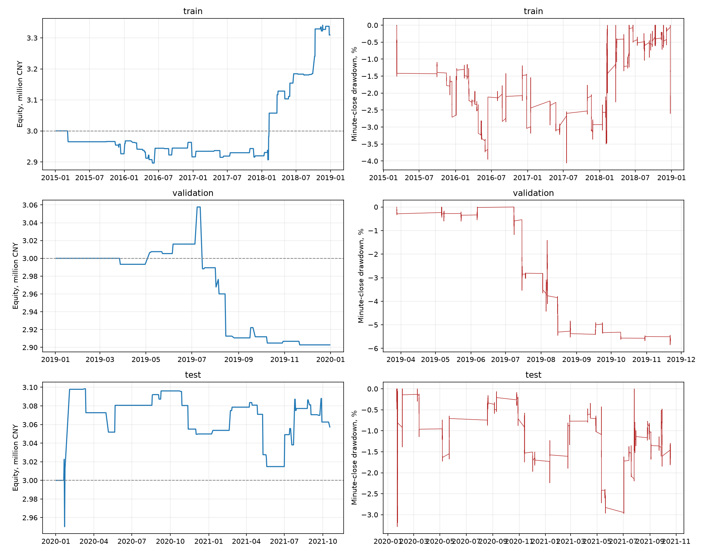
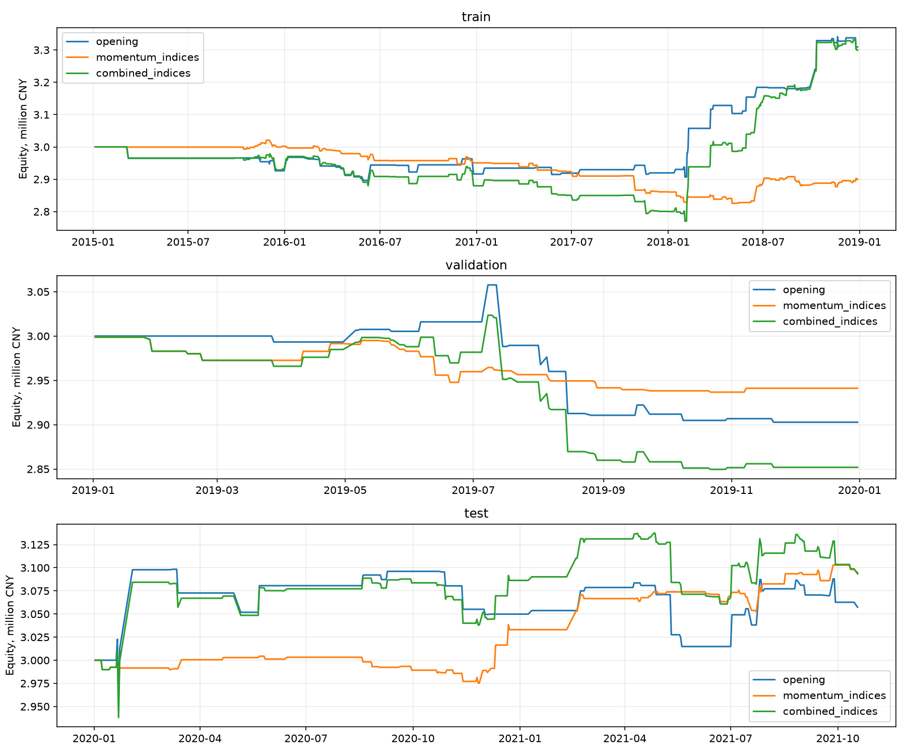

# Итоговый исследовательский отчёт MFT

Проект завершён как воспроизводимое исследование стратегий. Проверенные варианты
не подтверждают выполнение всех целевых требований. Положительное среднее на одну
сделку нельзя приравнивать к годовой доходности капитала или к доказанной стратегии.

## Данные и воспроизведение

Использованы исходные минутные IF, IC, IH. Исторические ноутбуки 01–04 сохранены.
Ноутбук 05 содержит обучение на IF и окончательный общий расчёт. Единый расчёт:
`python -m src.project_report`. Проверки: `python -m unittest discover -s tests -v`.
Все таблицы, сделки, минутная переоценка и SHA256 исходных файлов находятся рядом
с этим отчётом. Отчёт строится автоматически из фактических результатов.

| instrument | rows | bars | first_date | last_date |
| --- | --- | --- | --- | --- |
| IF | 712440 | 47496 | 2010-04-16 09:16:00 | 2021-10-18 15:00:00 |
| IC | 385470 | 25698 | 2015-04-16 09:16:00 | 2021-10-18 15:00:00 |
| IH | 385470 | 25698 | 2015-04-16 09:16:00 | 2021-10-18 15:00:00 |

Train — 2015–2018, validation — 2019, test — 2020 до фактического конца данных
2021-10-18. Периоды уже просматривались в ходе исследования: test здесь название
хронологического среза, а не нетронутая контрольная выборка. Каждый период начинает
с отдельного капитала 3 млн CNY. Три кривые нельзя склеить как единую историю счёта.

## Правила стратегии открытия

Закрытие первого 15-минутного бара сравнивается с фактическим закрытием предыдущего
торгового дня того же контракта. Если движение меньше отрицательного 80-го
процентиля абсолютных движений train, следующая свеча используется для входа short
по open. Выход — последнее закрытие дневной сессии. Порог фиксирован для каждого
инструмента. Сессии принимаются в наблюдаемых раскладках 18/16 полных баров.
Лаг предыдущего дня вычисляется до удаления неполных и смешанных дней.

| instrument | strategy | quantile | threshold | threshold_pct | train_observations |
| --- | --- | --- | --- | --- | --- |
| IC | opening | 0.800 | 0.009 | 0.913 | 863 |
| IF | opening | 0.800 | 0.008 | 0.787 | 927 |
| IH | opening | 0.800 | 0.008 | 0.787 | 863 |
| IF | momentum | 0.800 | 0.007 | 0.728 | 10094 |
| IC | momentum | 0.800 | 0.009 | 0.921 | 9338 |
| IH | momentum | 0.800 | 0.007 | 0.669 | 9338 |

Размер позиции — целое число контрактов по 0,5% от меньшего из начального и
текущего капитала, делённым на оценку риска одного контракта. Риск — стандартное
отклонение дневных доходностей за 20 прошлых дней (минимум 15 наблюдений), известное
до открытия. Оценка имеет нижнюю границу 0,1%. Лимиты: 20% капитала на маржу одной
позиции, 60% суммарно, 1,5% суммарного оценочного риска и максимум 20 контрактов,
с дополнительным консервативным лимитом 10 контрактов в ограниченном режиме
2015-09-07–2017-02-16. Если один контракт не помещается в бюджет, сделки нет.
0,5% — правило размера, не стоп-лосс и не гарантия максимального убытка.
На одном инструменте одновременно допускается одна позиция, без пирамидинга.
Одновременные входы обрабатываются по имени инструмента; это фиксированный порядок,
не оптимизация по результатам. Маржа переоценивается на каждом минутном close.

## Издержки и расхождения с прежними результатами

1 bp = 0,01%; 1‰ = 0,1% = 10 bp. Excel содержит 0,23‰ и 3,45‰, что буквально
соответствует 2,3 и 34,5 bp. Старый код использовал 0,23 и 3,45 bp.
Числа из таблицы Excel поэтому не являются подтверждённой историей тарифа.

Основной сценарий historical_proxy восстанавливает тариф открытия 0,25 bp до
2015-08-03, затем 0,23 bp; закрытие в тот же день: обычный тариф до 2015-08-26,
затем 1,15 bp, с 2015-09-07 — 23 bp, с 2017-02-17 — 9,2 bp,
с 2017-09-18 — 6,9 bp, с 2018-12-03 — 4,6 bp и с 2019-04-22 — 3,45 bp.
Также учтён сценарный сбор 1 CNY за каждую из двух поданных заявок с 2015-08-03.
Маржа: консервативные 40% до 2017-02-20; далее IF/IH 20%, затем 15%, с
2018-12-04 — 10%; IC 30%, с 2018-12-04 — 15%, с 2019-04-23 — 12%.
Это реконструкция основных режимов и консервативные допущения ранней маржи;
брокерские надбавки, все промежуточные изменения, особые параметры экспирации и
клиентские ограничения полностью не восстановлены. Нельзя назвать её точным
историческим моделированием исполнения и клиринга.

Источники для проверки: [раскрытие CFFEX 2024](https://www.cffex.com.cn/cn/zjssf/20240701/39212.html),
[исследование изменений правил Huatai](https://www.htfc.com/wz_upload/png_upload/20200827/15985190946611d21b3.pdf),
[уведомление о режиме сентября 2015](https://cfc108.com/zxjtqh/2015-09/05/article_414101.shtml),
[изменения декабря 2018](https://www.bhfcc.com/customer-center-ques-details.html?id=2095),
[публикация уведомления апреля 2019](https://www.qhfco.net/customer-service/trading-guide/trading-notice/494460d8-518b-11f0-89c7-b8e92477e4ec).
Тариф CFFEX 2024 приведён для проверки единиц и не применяется ретроспективно.

Проскальзывание основного расчёта — один тик на каждую сторону, то есть два тика
за полный круг. Комиссия считается от цены исполнения каждой стороны, PnL от
мультипликатора IF/IH 300, IC 200. Сравнение сценариев ниже на один контракт,
до портфельного отбора и размера позиций:

| fee_scenario | period | trades | mean_net_payoff_bps | median_net_payoff_bps | win_rate_pct | total_net_pnl_cny | naive_trade_t_statistic |
| --- | --- | --- | --- | --- | --- | --- | --- |
| legacy_constant | train | 232.000 | 64.017 | 21.517 | 54.741 | 1736605.511 | 3.387 |
| legacy_constant | validation | 50.000 | 17.979 | 19.785 | 60.000 | 95658.256 | 0.945 |
| legacy_constant | test | 124.000 | 24.016 | 5.173 | 53.226 | 355734.921 | 1.838 |
| historical_proxy | train | 232.000 | 56.058 | 13.614 | 52.586 | 1556298.736 | 2.946 |
| historical_proxy | validation | 50.000 | 17.728 | 19.785 | 60.000 | 94430.270 | 0.933 |
| historical_proxy | test | 124.000 | 24.016 | 5.173 | 53.226 | 355734.921 | 1.838 |
| workbook_per_mille | train | 232.000 | 31.109 | -11.523 | 48.276 | 950793.109 | 1.641 |
| workbook_per_mille | validation | 50.000 | -15.072 | -13.261 | 44.000 | -64917.440 | -0.790 |
| workbook_per_mille | test | 124.000 | -9.016 | -27.918 | 41.129 | -122318.791 | -0.688 |

## Итоги портфеля открытия

| index | annualized_return_pct | annualized_sharpe | max_drawdown_pct | minute_close_max_drawdown_pct | trades | win_rate_pct | maximum_margin_usage_pct |
| --- | --- | --- | --- | --- | --- | --- | --- |
| train | 2.495 | 0.753 | -3.456 | -4.061 | 87 | 57.471 | 48.805 |
| validation | -3.252 | -0.979 | -5.066 | -5.851 | 31 | 45.161 | 16.870 |
| test | 1.059 | 0.282 | -2.696 | -3.286 | 53 | 47.170 | 15.006 |

Годовая доходность — CAGR по фактическим календарным датам покрытия; Sharpe —
среднее/стандартное отклонение дневных доходностей × sqrt(252), ставка без риска 0.
В дневном календаре только наблюдаемые торговые даты, включая дни без сделок.
Просадка отсчитывается также от начальных 3 млн, чтобы первый убыток не исчезал.
Дневная и минутная просадки показаны раздельно. Минутная использует close и может
пропускать худшие движения внутри минуты. PnL сделок сверяется с итогом переоценки.

Средний payoff всех сигналов по одному контракту и доходность итогового портфеля
могут иметь разный знак. Правило размера пропускает часть сигналов, если один
контракт слишком велик для бюджета, и назначает разное число контрактов остальным.
В 2019 эта разница существенна: положительное среднее всех сигналов не сохранилось
в фактическом портфеле. Таблицы allocated_trades.csv и cost_sensitivity.csv позволяют
проверить это напрямую. Порог и размер не меняются ради исправления результата.

| period | year | trades | mean_net_payoff_bps | median_net_payoff_bps | win_rate_pct | total_net_pnl_cny | naive_trade_t_statistic |
| --- | --- | --- | --- | --- | --- | --- | --- |
| test | 2020 | 26.000 | 10.871 | -1.502 | 50.000 | 49841.186 | 0.321 |
| test | 2021 | 27.000 | 1.723 | -11.131 | 44.444 | 7479.468 | 0.080 |
| train | 2015 | 6.000 | -148.663 | -126.489 | 33.333 | -73836.459 | -1.682 |
| train | 2016 | 26.000 | -3.780 | -28.724 | 38.462 | -9870.790 | -0.123 |
| train | 2017 | 11.000 | 1.266 | 33.248 | 54.545 | 3319.685 | 0.036 |
| train | 2018 | 44.000 | 87.513 | 91.334 | 72.727 | 389661.661 | 3.696 |
| validation | 2019 | 31.000 | -30.571 | -27.016 | 45.161 | -97217.632 | -1.451 |

## Сравнение и комбинация

Часовой сигнал пересчитан на одинаковой вселенной IF/IC/IH: отрицательное движение
за четыре бара выше train-порога по модулю, вход на следующем open и выход после
четырёх баров внутри той же непрерывной сессии. Это исправленная сопоставимая
версия, отличающаяся от старого ноутбука 03, где также был RU и вход по close.
RU не включён в это сравнение, чтобы не смешивать календари и схемы комиссий.
Комбинация принимает оба сигнала с общими лимитами, запрещает пересечение позиций
одного инструмента и не использует будущую прибыль для выбора сигнала.

| strategy | period | annualized_return_pct | annualized_sharpe | max_drawdown_pct | minute_close_max_drawdown_pct | trades | win_rate_pct | maximum_margin_usage_pct |
| --- | --- | --- | --- | --- | --- | --- | --- | --- |
| opening | train | 2.495 | 0.753 | -3.456 | -4.061 | 87 | 57.471 | 48.805 |
| opening | validation | -3.252 | -0.979 | -5.066 | -5.851 | 31 | 45.161 | 16.870 |
| opening | test | 1.059 | 0.282 | -2.696 | -3.286 | 53 | 47.170 | 15.006 |
| momentum_indices | train | -0.853 | -0.528 | -6.459 | -6.709 | 173 | 45.665 | 49.421 |
| momentum_indices | validation | -1.969 | -1.640 | -2.109 | -3.058 | 43 | 23.256 | 11.136 |
| momentum_indices | test | 1.748 | 1.112 | -0.972 | -1.909 | 99 | 52.525 | 14.683 |
| combined_indices | train | 2.418 | 0.653 | -7.655 | -8.036 | 229 | 51.965 | 50.256 |
| combined_indices | validation | -4.952 | -1.418 | -5.749 | -6.462 | 63 | 31.746 | 17.110 |
| combined_indices | test | 1.722 | 0.430 | -2.444 | -3.299 | 125 | 48.800 | 15.069 |

## Статистика и устойчивость

Средние, медианы и win rate в таблицах сделок относятся к фактически принятым
сделкам после издержек. Payoff — доля номинала контракта, не доходность маржи или
счёта. Наивный trade t-statistic только описательный: IF/IC/IH зависимы.
Для среднего дневного PnL дополнительно рассчитан воспроизводимый 95%-й интервал
блочным bootstrap (блок 5 торговых дней, 1000 повторов, seed 42), с одновременным
объединением инструментов по дню и включением нулевых дней. Интервал не исправляет
множественный перебор идей и просмотр контрольных данных.

| period | mean_daily_pnl_cny | block_bootstrap_low_cny | block_bootstrap_high_cny |
| --- | --- | --- | --- |
| train | 317.204 | -108.489 | 794.452 |
| validation | -398.433 | -1271.308 | 347.850 |
| test | 132.687 | -486.242 | 849.371 |

Таблица robustness.csv проверяет train-квантили 70/80/90% и 1/2/3 тика на сторону.
Это диагностика payoff всех сигналов по одному контракту, а не повторный подбор
оптимальных параметров капитала на test. Средние взвешены числом сделок через
агрегацию самих сделок, а не равными весами инструментов.

## Проверка задания и вывод

| index | annualized_return_pct | annualized_sharpe | max_drawdown_pct | minute_close_max_drawdown_pct | trades | win_rate_pct | maximum_margin_usage_pct | return_above_20pct | sharpe_above_1_5 | drawdown_below_15pct | required_goals_pass |
| --- | --- | --- | --- | --- | --- | --- | --- | --- | --- | --- | --- |
| train | 2.495 | 0.753 | -3.456 | -4.061 | 87 | 57.471 | 48.805 | False | False | True | False |
| validation | -3.252 | -0.979 | -5.066 | -5.851 | 31 | 45.161 | 16.870 | False | False | True | False |
| test | 1.059 | 0.282 | -2.696 | -3.286 | 53 | 47.170 | 15.006 | False | False | True | False |

Цели: годовая доходность >20%, Sharpe >1,5, максимальная просадка <15%; win rate
>50% — дополнительная метрика. На показанных хронологических срезах стратегия
не удовлетворяет всем обязательным условиям. Комбинация также должна оцениваться
по таблице выше, а не по прежним иллюстративным числам. Законченный исследовательский
результат — неподтверждённый кандидат, а не обещание прибыльной торговли.

Дни смены контракта и неполные дни отбрасываются по всей дневной записи. Это
ex-post фильтр качества данных: вживую нельзя заранее узнать все смены символа
и пропуски. Потребуется известное заранее правило выбора контракта и полный
контрактный архив. Ограничения OHLC: цены открытия/закрытия не гарантируют исполнение,
нет bid/ask и очереди, модель не проверяет отсутствие встречной ликвидности на
лимитах. Размер позиции не проверен по доступному объёму каждого исполнения;
нет stop-loss, брокерского маржинального механизма и затрат на инфраструктуру.
Результат исследования не является разрешением запускать стратегию в торговлю.

Практическое продолжение после завершения проекта: получить свежий контрольный
период и контрактные данные, проверить календарь роллов, реальные брокерские
издержки и ликвидность. Новые модели, включая ML, потребуют новой контрольной
выборки. На этих данных увеличение плеча или подбор параметров ради требований
задания не доказывает наличие устойчивого преимущества.

